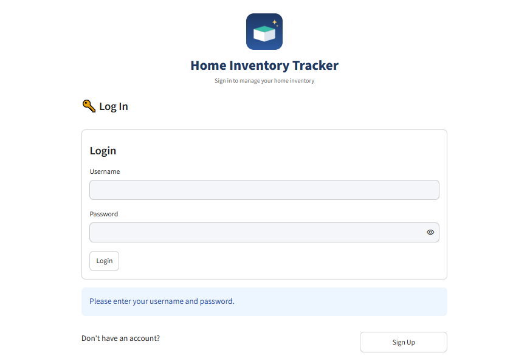
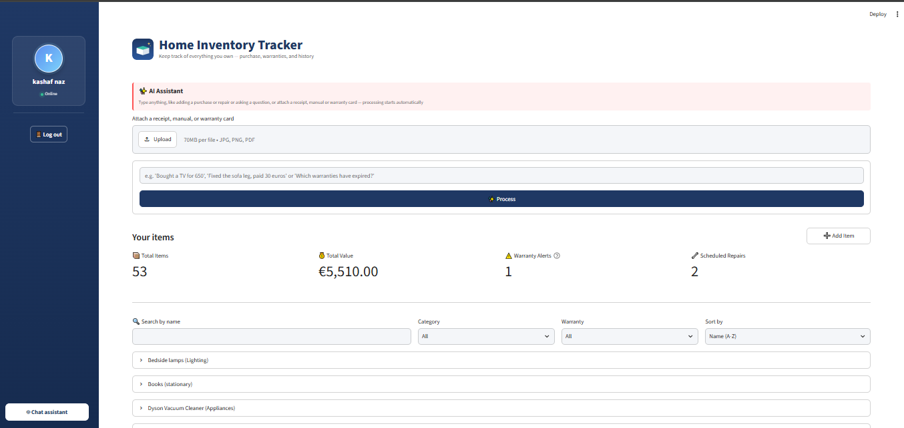
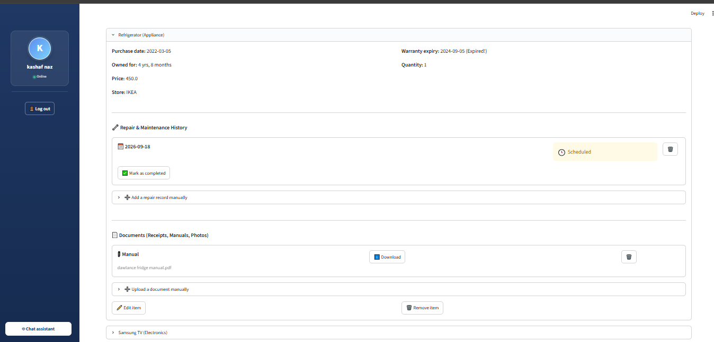
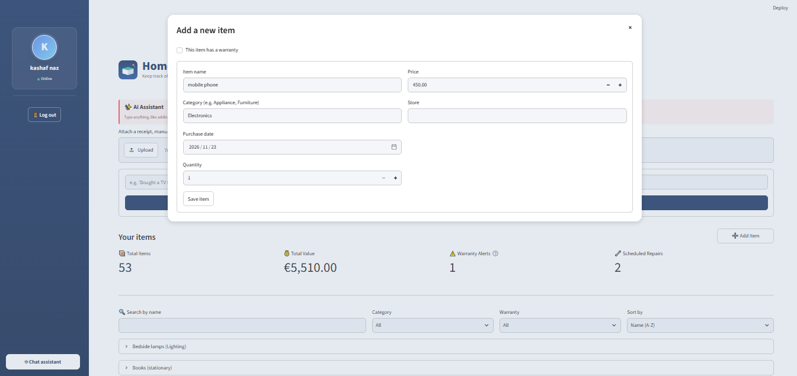
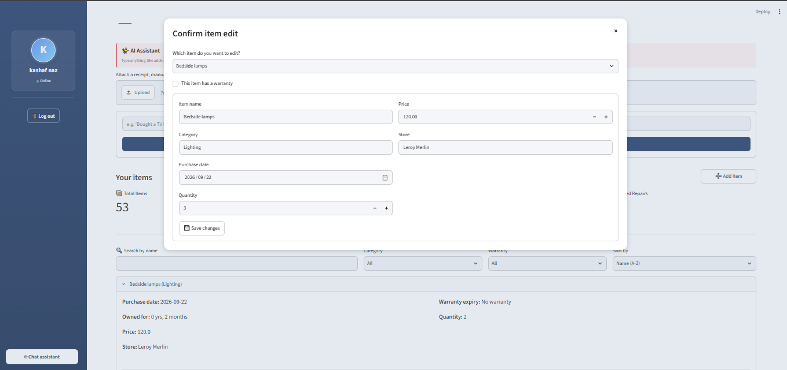

# AI Inventory Tracker

An AI-powered home inventory management application built with Python and Streamlit. The application combines inventory management, receipt scanning, document processing, OCR, and AI-assisted operations to simplify the organization and management of household items.

## Project Purpose

Managing household items, recording new purchases, keeping track of product details, and finding manuals or maintenance instructions can become difficult over time.

This project aims to solve these problems by providing a centralized platform where users can manage household inventory, extract information from purchase receipts, upload product documents, and interact with an AI assistant to retrieve information and perform inventory operations.

## Problems This Project Addresses

- **Disorganized Household Inventory:** Provides a centralized platform to maintain household item records.
- **Manual Receipt Processing:** Reduces the effort required to transfer purchased item details from receipts into household inventory.
- **Time-Consuming Manual Data Entry:** Uses AI-assisted classification and information extraction to process inventory details.
- **Difficulty Finding Product Information:** Allows users to upload manuals and related documents instead of searching through separate files.
- **Difficult Document Searches:** Provides text extraction, OCR support, and document search capabilities.
- **Limited Access to Product Information:** Allows users to ask questions about uploaded manuals through an AI assistant.
- **Manual Inventory Updates:** Allows users to add or edit inventory records using natural-language commands.

## Key Features

- **User Authentication:** Login and registration functionality.
- **Inventory Management:** Manage household inventory records.
- **Receipt Scanning & Data Extraction:** Read uploaded purchase receipts and extract relevant item information.
- **Automated Inventory Creation from Receipts:** Use extracted receipt information to create inventory records, reducing manual data entry.
- **AI-Powered Classification:** Automatically classify and extract relevant information from submitted content.
- **AI-Powered Record Creation:** Add new inventory records using natural-language commands.
- **AI-Powered Record Editing:** Update existing inventory records through conversational instructions.
- **Confirmation Popup:** Review AI-extracted information and confirm details before applying inventory changes.
- **Document Management:** Upload and process product manuals and documents.
- **PDF Text Extraction:** Extract text from PDF documents.
- **OCR Support:** Extract text from scanned documents and image-based PDFs.
- **AI Manual Assistant:** Ask questions about uploaded product manuals.
- **Document Search:** Find relevant information within uploaded manuals.
- **Streamlit Interface:** Interactive dashboard for managing inventory and accessing AI features.

## Technology Stack

- **Programming Language:** Python
- **Application Framework:** Streamlit
- **AI Integration:** OpenRouter
- **Data Processing:** Pandas, NumPy
- **Database:** SQLite
- **Document Processing:** PyMuPDF
- **OCR:** RapidOCR, rapidocr-onnxruntime
- **Authentication:** Streamlit Authenticator
- **Configuration:** YAML, Python dotenv

## Application Screenshots

### Sign In / Sign Up



### Main Dashboard



### Inventory Management



### AI-Powered Record Creation & Editing




### AI Manual Assistant


## AI-Assisted Inventory Operations

The application provides multiple ways to add and manage household inventory using AI.

**1. Receipt-Based Inventory Creation**

- Upload purchase receipts for information extraction.
- Read receipt contents and identify relevant purchased item details.
- Use the extracted information to create inventory records, reducing repetitive manual entry.

**2. Natural-Language Record Creation**

- Add new inventory items by describing their details through conversational commands.
- Let AI process the instructions and extract relevant inventory information.
- Review the extracted details in a confirmation popup before applying changes.

**3. Natural-Language Record Editing**

- Update existing inventory records using conversational instructions.
- Review the proposed changes in a confirmation popup before saving.

**4. AI-Powered Manual Assistant**

- Upload product manuals and related documents.
- Extract information from PDF files, including scanned documents through OCR.
- Ask questions about uploaded manuals and retrieve relevant information.

These features combine AI-assisted data extraction, document processing, and conversational interaction to simplify household inventory management.

## Project Structure

```text
AI_inventory_tracker/
│
├── .streamlit/
│   └── config.toml
│
├── screenshots/
│   ├── sig_in_page.png
│   ├── Main_Dashboard.png
│   ├── Inventory_Management.png
│   ├── add_record.png
│   ├── edit_record.png
│   └── Ai_assistant.png
│
├── ai_helper.py
├── app.py
├── database.py
├── inventory_logo.png
├── requirements.txt
├── .gitignore
└── README.md
```

## Installation and Setup

1. Clone the repository:

   ```bash
   git clone YOUR_GITHUB_REPOSITORY_URL
   cd AI_inventory_tracker
   ```

2. Create a virtual environment:

   ```bash
   python -m venv venv
   ```

3. Activate the environment:

   **Windows PowerShell:**

   ```powershell
   .\venv\Scripts\Activate.ps1
   ```

4. Install dependencies:

   ```bash
   pip install -r requirements.txt
   ```

5. Configure your environment variables and authentication settings locally. The private `.env` and `config.yaml` files are intentionally excluded from this repository.

6. Run the application:

   ```bash
   streamlit run app.py
   ```

## Security Note

This repository does not include private API credentials, authentication configuration, local databases, uploaded documents, or virtual environment files.

Users must configure their own credentials and local application settings before running the project.